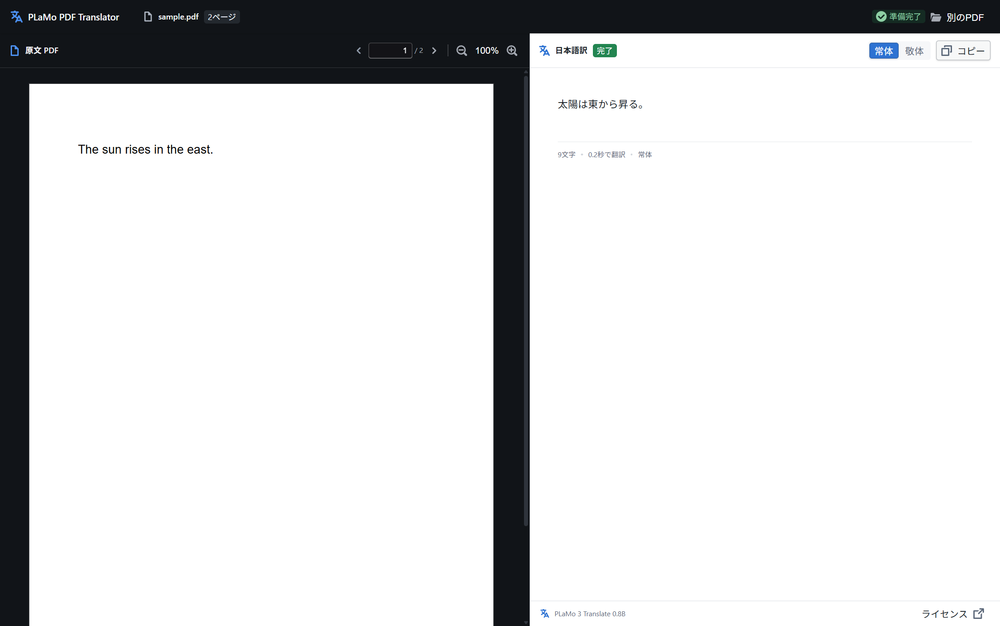

# PLaMo PDF Translator

英語 PDF の原文と日本語訳を左右に表示する Windows / macOS アプリ

表示中のページを PLaMo 3 Translate 0.8B でローカル翻訳します

Built with PLaMo



## リリース版

[GitHub Releases](https://github.com/matsuvr/side_by_side_pdf_translator/releases) の
macOS Apple Silicon 向けZIPには、Metal対応アプリとPreferred Networksの公式GGUF
`plamo-3-translate-0.8b-Q4_K_M.gguf`、ライセンス文書を同梱しています。

ZIPを展開し、フォルダ内の `PLaMo PDF Translator.app` を起動してください。
アプリとGGUFを同じフォルダに保つと、起動時にモデルを自動検出します。
モデルを追加ダウンロードせず、オフラインで翻訳できます。
フォルダを移す場合はGGUFも一緒に移してください。

macOS 11以降のApple Silicon Macが対象です。配布アプリはad-hoc署名で、Developer ID署名・公証は行っていません。
Windows版のソースとビルド手順も以下に記載しています。

起動画面に「Built with PLaMo」を表示し、「PLaMoコミュニティライセンス契約（ローカル）」から
同梱モデルの契約全文を開けます。アプリ本体のMITライセンスは配布文書に収録しています。

## ビルド

Windows x64 向けのビルドには次のツールが必要です

- Node.js 22.13 以上と pnpm 9.14.4
- Rust 1.90 以上の MSVC ツールチェーン
- Visual Studio Build Tools の「C++ によるデスクトップ開発」と Windows SDK
- CMake と LLVM の libclang

`libclang.dll` が見つからない場合は `LIBCLANG_PATH` にそのフォルダを設定してください

```powershell
git clone https://github.com/matsuvr/side_by_side_pdf_translator.git
cd side_by_side_pdf_translator
pnpm install --frozen-lockfile
pnpm build
```

インストーラーの出力先は `src-tauri/target/release/bundle/nsis/`

Windows での実行には WebView2 Runtime と Visual C++ 再頒布可能パッケージ x64 が必要です

[WebView2 Runtime](https://developer.microsoft.com/microsoft-edge/webview2/) · [Visual C++ 再頒布可能パッケージ](https://learn.microsoft.com/ja-jp/cpp/windows/latest-supported-vc-redist)

### macOS (Apple Silicon)

Node.js と pnpm、Rust に加え、Xcode または Xcode Command Line Tools と CMake が必要です

```sh
pnpm install --frozen-lockfile
pnpm build:mac
```

Metal 対応のアプリは `src-tauri/target/release/bundle/macos/PLaMo PDF Translator.app` に出力されます

ソースからビルドする場合は、公式GGUFモデルを `.app` と同じフォルダに配置してください。
`pnpm build:mac` はアプリを作成し、以下のパッケージ手順でGGUFをZIPに収録します。

ローカル確認用に ad-hoc 署名する場合は次のコマンドを使えます。Developer ID 署名と公証は含まれません

```sh
codesign --force --deep --sign - 'src-tauri/target/release/bundle/macos/PLaMo PDF Translator.app'
```

## モデルと PDF を開く

1. リリースZIPを展開し、アプリを起動（同梱モデルを自動検出）
2. 「PDFを開く」またはドラッグ＆ドロップで読み込み
3. 左右の矢印キーでページ移動

ソースからのビルドやモデル未配置の場合は、起動画面の「GGUFモデルをダウンロード」から
公式GGUFを取得し、「フォルダを開く」で表示した配置先に保存して「再スキャン」してください。

モデルの配布元は Preferred Networks です

画像だけのページの OCR には対応していません

## 開発

| コマンド | 内容 |
| --- | --- |
| `pnpm dev` | Tauri の開発モードで起動 |
| `pnpm typecheck` | TypeScript の型チェック |
| `node scripts/msvc.mjs cargo test --locked --manifest-path src-tauri/Cargo.toml` | Rust のテスト |
| `pnpm smoke` | プロジェクト直下の GGUF で翻訳を確認 |
| `pnpm build:release` | CPU 版の実行ファイルを作成 |
| `pnpm build:cuda` | CUDA Toolkit を使用して NVIDIA GPU 向けにビルド |
| `pnpm build:mac` | macOS 向けの Metal 対応 `.app` を作成 |

Vulkan SDK を使う場合は `node scripts/msvc.mjs tauri build --no-bundle --features vulkan`

macOS のテスト結果は [macOS 動作確認](docs/macos-validation.md) を参照してください

動作確認済みの構成は Windows x64 の CPU 版と Apple M4 の macOS Metal 版です

開発時のモデル配置先はプロジェクト直下

配布版の配置先は実行ファイルと同じフォルダです

### リリースZIPの作成（macOS）

公式GGUFをプロジェクト直下に用意し、ビルド後に実行します。Python 3とmacOSの`ditto`を使用します。

```sh
pnpm build:mac -- --locked
codesign --force --deep --sign - 'src-tauri/target/release/bundle/macos/PLaMo PDF Translator.app'
python3 scripts/package-release.py
```

`build/releases/` に `.app`・GGUF・README・ライセンス一式を含むZIPとSHA-256ファイルを出力します。
GGUFのサイズとSHA-256を [公式配布物の記録](licenses/plamo-model.json) と照合し、不一致なら作成を中止します。
モデルの重みはGitに追加せず、リリースZIPだけに収録します。

実行ファイルを単体で再配布する場合も、`licenses/` フォルダ（アプリ本体のMIT全文を含む）、
`THIRD_PARTY_NOTICES.md`、`THIRD_PARTY_LICENSES.txt` を添付してください。
モデルも再配布する場合は、以下のPLaMoの条件に従い、READMEとモデルの契約全文も添付してください。

## ライセンス

| 対象 | 適用ライセンス |
| --- | --- |
| アプリ本体のソースコード | [MIT License](LICENSE) |
| 同梱GGUFモデル（Preferred Networks） | [PLaMo Community License 日本語全文](licenses/PLAMO_COMMUNITY_LICENSE-ja.txt) / [English](licenses/PLAMO_COMMUNITY_LICENSE-en.txt) |
| 依存ライブラリ | [Third-party notices](THIRD_PARTY_NOTICES.md) / [ライセンス集](THIRD_PARTY_LICENSES.txt) |

アプリ本体のMITライセンスはモデルには適用されません。
同梱モデルを利用する前にPLaMo Community License全文を確認し、その条件を遵守してください。
契約への同意またはモデルの利用により同契約に拘束されます。

以下はモデルの条件の概要です。完全な条件は上記の同梱契約全文を参照してください。

- 私的利用（学習・趣味等）や学術用途を含む非商用利用は、事前登録なしで無償です。
- 商業目的の利用（組織内部での事業利用を含む）は、ユーザーまたは関係会社の直近事業年度の収入・売上が10億円を超えない場合、[PFNへの事前登録](https://forms.gle/mTL8tBLrMYXKNZD56)が必要です。10億円を超える場合は別途PFNから商業用ライセンスを取得する必要があります。
- モデルを再配布するときは、契約全文を提供して受領者にも条件を遵守させ、「Built with PLaMo」を表示してください。派生モデルや他の適用ライセンスについても契約第4条に従ってください。
- 翻訳結果を独立した長文の公表物（書籍・論文等）の全部または実質的な部分として公表する場合は、奥付・謝辞・末尾等にPLaMoを翻訳に利用した旨を明示してください（第5条）。
- 生成物を用いて学習したモデルにも同契約が適用されます。生成物やそれを含むデータセットを第三者に提供・公開するときは、その旨が相手に分かるよう表示してください。
- 年齢要件、禁止行為、第三者の権利の確保、無保証など、契約のその他の条件も適用されます。

[モデルカード](https://huggingface.co/pfnet/plamo-3-translate-0.8b-GGUF) · [モデルと契約全文の出典](licenses/README.md)
